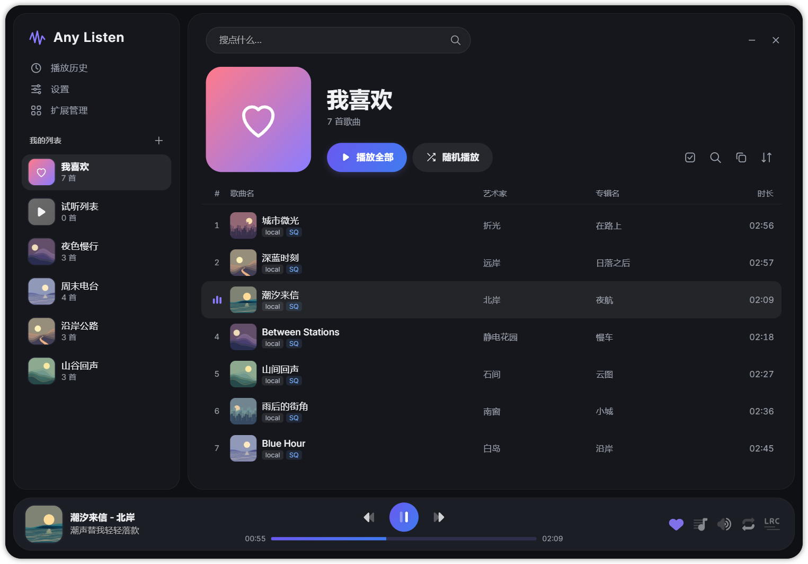
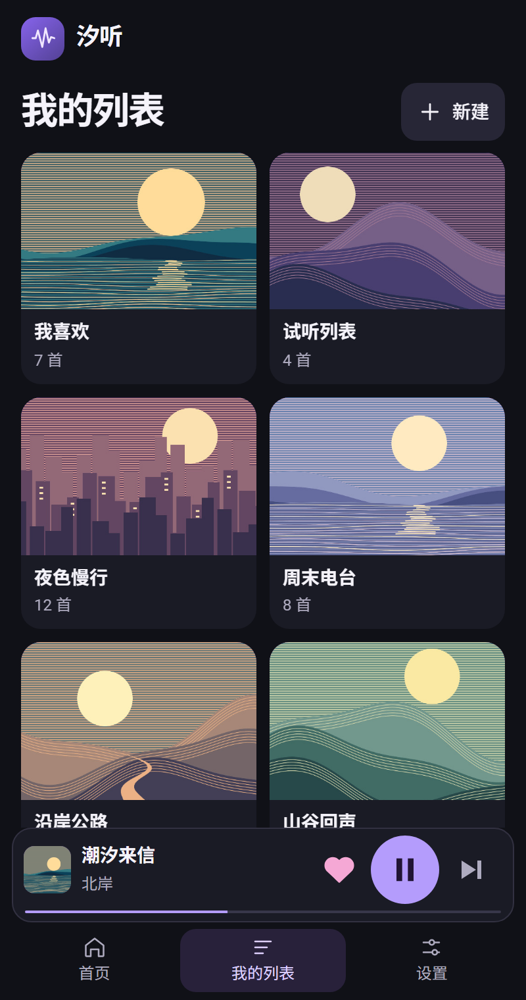
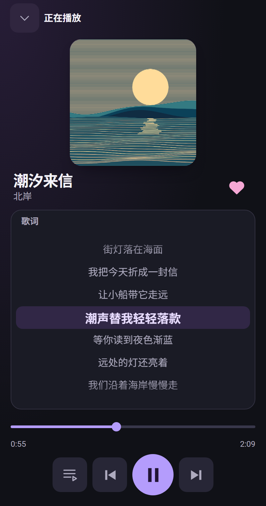
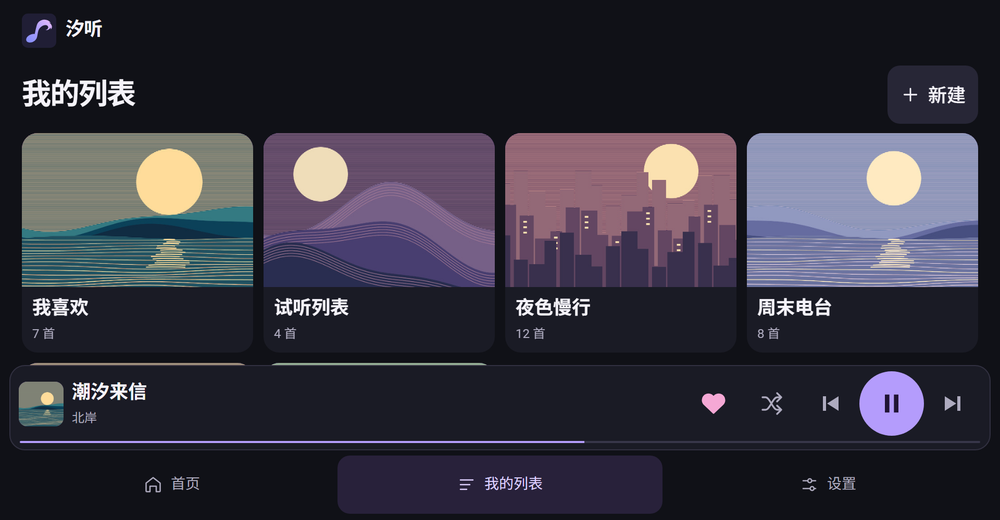
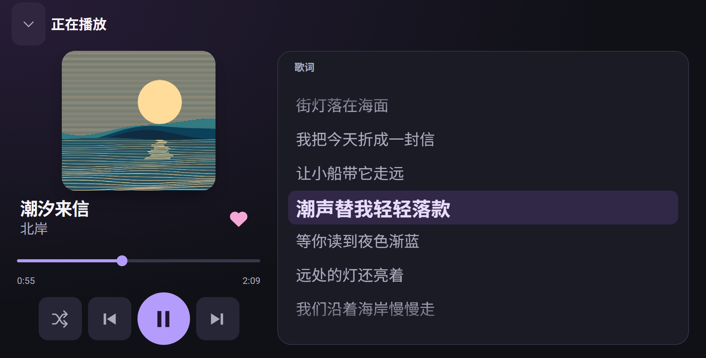

# 汐听 TideListen


基于 [Any Listen](https://github.com/any-listen/any-listen) 的个人非商业改版，由 songjiezhang 维护。默认主题为 Midnight。Windows 桌面端沿用上游的播放器和扩展机制。Android 手机和横屏车机使用独立的 Media3 客户端，三端通过汐听同步服务或 WebDAV 共享歌单与排列顺序。

**本项目是Codex的个人Vibe Coding产物，未经广泛测试，不提供技术支持，敬请谅解。**

## 界面预览

v0.12.1 的三端共用「浪尖音符」图标。桌面截图来自 Windows 版实际运行界面。手机和车机预览分别用 Android 和 Android-Car 安装包中的页面按竖屏、横屏尺寸渲染。歌单、封面和歌词均为演示内容。

### Windows 桌面端



### Android 手机

| 我的列表 | 播放与同步歌词 |
| --- | --- |
| [](docs/images/midnight/phone-lists.png) | [](docs/images/midnight/phone-player.png) |

### Android 横屏车机

**我的列表**



**播放与同步歌词**



## 下载安装

本仓库以 **v0.13.7** 作为 Release 的起始版本。请在 [Releases](https://github.com/songjiezhang/tide-listen/releases/latest) 下载对应设备的安装包。

| 设备 | 安装包文件名 | 软件内更新入口 |
| --- | --- | --- |
| Windows x64 | `TideListen-版本-x64-Setup.exe` | 设置 → 软件更新 → 检查更新 |
| Android 手机 | `TideListen-Android-版本.apk` | 设置 → 关于 → 检查更新 |
| Android 横屏车机 | `TideListen-Android-Car-版本.apk` | 设置 → 关于 → 检查更新 |

Android 最低支持 6.0。车机需要支持直接安装 APK。从 0.12.0 或更早的 Android 版升级时，请手动下载对应 APK 覆盖安装一次，保留歌单、设置和已导入的音源。0.12.1 起，手机和车机分别按 Android 和 Android-Car 文件名检查更新。Android 8.0 及以上首次应用内更新时，请在系统页面允许该应用安装更新，再返回播放器。Windows 安装包没有 Authenticode 签名，Release 附有 SHA-256 校验值。

## 播放与歌单

- 桌面端使用 Midnight 圆角主题，支持按链接更新已导入的洛雪 JS 音源，按启用音源的优先级依次解析。桌面在线歌单和歌词通过扩展管理器获得。
- 手机和车机在「设置 → 音源」调整优先级。播放时依次尝试支持歌曲平台和所选音质的已启用音源，第一个可播放的音源成功后即停止。首选音质没有可用结果时，再尝试更低音质。「音源默认」直接使用每个音源的默认音质。
- Android 首页内置 Online Metadata v0.4.9 的歌单和排行榜模块，可浏览酷狗、酷我、网易、企鹅和咪咕的公开歌单。首页先显示缓存，再后台刷新。播放页使用同一扩展获取同步歌词。
- 选择 WebDAV 同步时，在 Android 设置中填写与桌面端相同的同步目录，即可按原名称查看「我的列表」。添加、收藏、编辑与排序会自动同步。播放网络歌曲所需的 JS 音源由使用者自行从有权使用的来源导入。
- 手机重新打开后恢复上次曲目、队列和进度。车机默认打开后继续播放，横屏左侧为封面和控制，右侧为滚动歌词。

### 编辑、更新与排序

从在线资源收藏歌单或排行榜，三端都会保存平台、资源类型与原列表链接或 ID。桌面右键歌单，手机和车机进入歌单后点击「编辑列表」或「更新列表」。更新会按平台当前内容替换歌曲和顺序，歌单名称与列表 ID 继续保留。

老版本 Android 收藏的普通列表可以在首页打开对应的在线资源，选择「关联已有列表」。也可以在「编辑列表」将普通列表设为在线列表并填写平台、资源类型与原列表链接或 ID。关联后可先检查来源，再点「更新列表」。桌面使用该来源时需要启用 Online Metadata 扩展。

桌面直接拖动侧栏中的自建歌单，或拖动歌单里的歌曲序号到目标行。手机和车机在「我的列表」或歌单详情点击「排序」，拖动手柄后点击「完成排序」。「我喜欢」与可选的「试听列表」固定在顶部，其中的歌曲可以排序。

## 自托管同步

桌面、手机和车机可以通过同步服务共享歌单，并按需同步音源。已有服务可以直接[配对设备](sync-server/README.md#网页与设备)。已有实例更新镜像时，请按[升级说明](sync-server/README.md#检查部署和升级)保留原来的数据卷和密钥卷。

### Docker Compose 快速部署

首次部署时，在装有 Docker Compose 的 NAS 或 VPS 上新建一个目录，把下面两段配置分别保存为 `compose.yaml` 和 `.env`。启动时会从 Docker Hub 拉取镜像。

**`compose.yaml`**

```yaml
services:
  tide-sync:
    container_name: tide-listen-server
    image: zjuzsj/tide-listen-server:latest
    environment:
      SYNC_PUBLIC_URL: "https://${SYNC_DOMAIN:?请设置 SYNC_DOMAIN}"
      SYNC_TRUST_PROXY: "1"
      SYNC_ADMIN_USERNAME: "${SYNC_ADMIN_USERNAME:-admin}"
      SYNC_ADMIN_PASSWORD: "${SYNC_ADMIN_PASSWORD:-}"
    ports:
      - "${SYNC_LOCAL_PORT:-8472}:8472"
    volumes:
      - data:/data
      - secrets:/secrets
    restart: unless-stopped
    security_opt: [no-new-privileges:true]
    healthcheck:
      test: ["CMD", "node", "-e", "fetch('http://127.0.0.1:8472/health').then(r=>{if(!r.ok)process.exit(1)}).catch(()=>process.exit(1))"]
      interval: 30s
      timeout: 4s
      retries: 3
volumes:
  data:
  secrets:
```

**`.env`**

```dotenv
SYNC_DOMAIN=sync.example.com
SYNC_LOCAL_PORT=8472
SYNC_ADMIN_USERNAME=admin
SYNC_ADMIN_PASSWORD=
```

首次启动前，填写以下两项配置。

- `SYNC_DOMAIN` 填对外访问的域名，例如 `sync.example.com`，省略协议和路径。服务用它识别网页登录地址，HTTPS 由反向代理提供。
- `SYNC_ADMIN_PASSWORD` 填 12 至 128 个字符的初始密码。初始管理员默认为 `admin`，可以通过 `SYNC_ADMIN_USERNAME` 修改。已有数据库继续使用原来的账号和密码。

默认在宿主机的所有网络接口上发布 HTTP 端口 `8472`。公网访问走 HTTPS 反向代理，宿主机端口只需对代理开放。如果端口已被占用，修改 `SYNC_LOCAL_PORT` 即可。

在这两个文件所在的目录运行：

```bash
chmod 600 .env
docker compose up -d
```

将域名解析到反向代理。代理运行在宿主机上时，将该域名的 HTTPS 请求转发到 `http://127.0.0.1:8472`。如果改过 `SYNC_LOCAL_PORT`，转发目标也要使用新端口。

以 `sync.example.com` 为例，管理员登录 `https://sync.example.com/admin` 创建用户，为同一用户的每台设备各生成一个配对码。客户端填写服务根地址 `https://sync.example.com` 和本机的配对码。桌面端配对后再选择「合并本机歌单并开启同步」或「从 WebDAV 迁移」。

使用容器内的反向代理或迁移现有歌单时，参见 [Caddy 部署](sync-server/README.md#使用随附的-caddy)和 [WebDAV 歌单迁移](sync-server/README.md#从-webdav-迁移歌单)。

## 仓库结构

| 目录 | 用途 |
| --- | --- |
| `packages/desktop` | Electron 主进程、Windows 安装包和桌面同步 |
| `packages/view-main`、`packages/view-lyric` | 桌面播放器界面与独立歌词窗口 |
| `packages/android` | 手机和车机共用的 Media3、WebView、歌单存储与在线资源适配 |
| `packages/shared` | 桌面和 Web 共用的数据库、扩展运行时、类型与国际化 |
| `packages/web-server` | 上游 Web 播放器服务 |
| `sync-server` | 汐听配对同步服务、网页管理、Docker 配置与集成测试 |
| `docs/images` | README 使用的界面截图 |

安装包与本地构建缓存保存在忽略目录中，正式下载入口是 GitHub Releases。

## 从源码构建

请检出与安装包一致的 Release 标签。桌面端需要 Node.js 22.12 或更高版本，以及项目根目录 `packageManager` 指定的 pnpm 10。在 Windows x64 的干净工作副本中执行：

```sh
pnpm install --frozen-lockfile
pnpm build:desktop
pnpm -F desktop pack:win:setup:x64
```

Windows 安装包位于根目录 `build/`。Android 使用 JDK 17 和 Android SDK 35，在 `packages/android` 下运行 `./gradlew assemblePhoneRelease assembleDashboardRelease`（Windows 使用 `gradlew.bat`）。Release APK 需使用自己的私钥签名，个人签名构建可通过同一密钥覆盖升级。详见 [Android 说明](packages/android/README.md)。

发布稳定版使用 `v主版本.次版本.修订号` 标签。提高桌面和 Android 的版本号，同时递增 Android versionCode。同一个 Release 应包含三个安装包、electron-builder 的 `latest.yml`、安装包对应的 `.blockmap` 和校验文件。Windows 从发布资料读取版本与 SHA-512，Android 从 GitHub Release 读取对应 APK 的大小和 SHA-256。

## 上游、改动与许可证

本项目是独立改版。原项目版权及署名归 Any Listen 原作者和贡献者。此次修改日期为 **2026-11-20**，基线为 [Any Listen 提交 8f6e746](https://github.com/any-listen/any-listen/commit/8f6e74641c708219e6933041a93bf2750ed9b1f2)。改动包括 Midnight 桌面界面、音源管理、Android 手机与车机客户端及软件内更新。标签对应完整源码和构建脚本。

沿用上游的 [自定义许可证](LICENSE)，即 AGPL v3 正文及非商业附加条款。未经原作者明确书面许可，禁止商业使用及直接或间接创收。本项目免费分发，无广告、收费服务或捐赠入口。软件按现状提供。音乐、歌词、封面及第三方音源的权利归各自权利人。

Android 适配了 [Online Metadata v0.4.9](https://github.com/any-listen/any-listen-extension-online-metadata/tree/v0.4.9) 和 [LX Music Mobile](https://github.com/lyswhut/lx-music-mobile) 的部分代码，两者使用 Apache-2.0。LX Music Mobile 同时列有[项目补充条款](https://github.com/lyswhut/lx-music-mobile#项目协议)。实体解码库 he 使用 MIT 许可。相关声明位于 [Android 第三方许可](packages/android/src/main/assets/licenses)。
